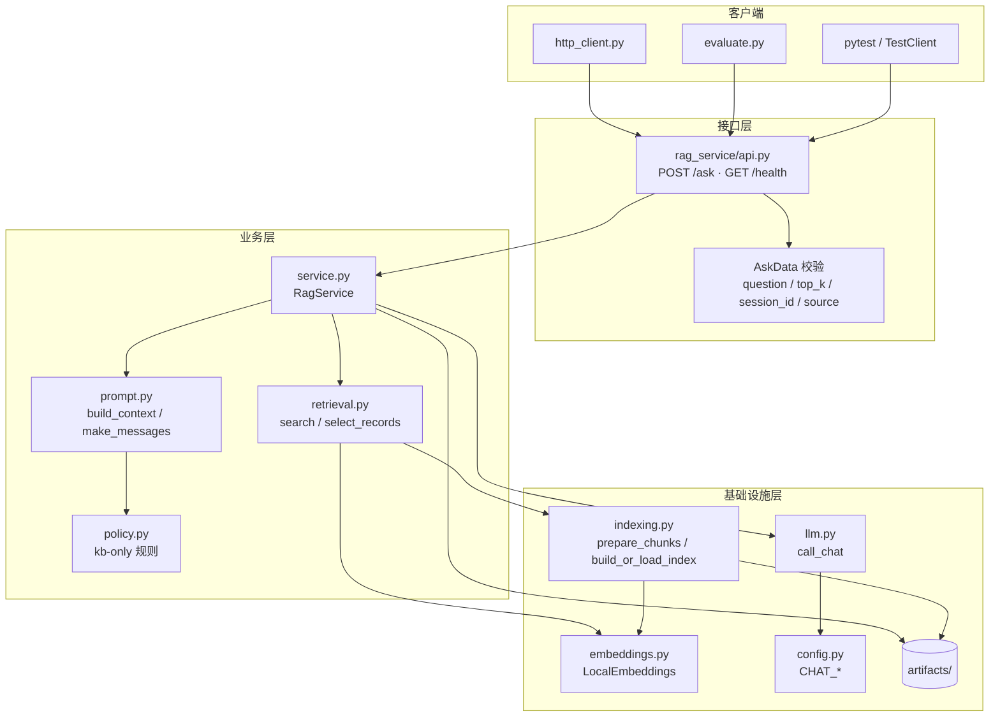
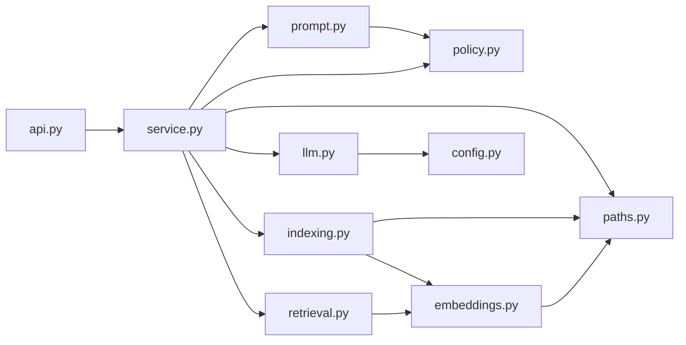
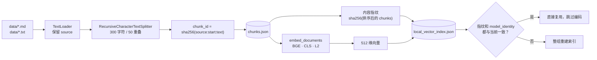
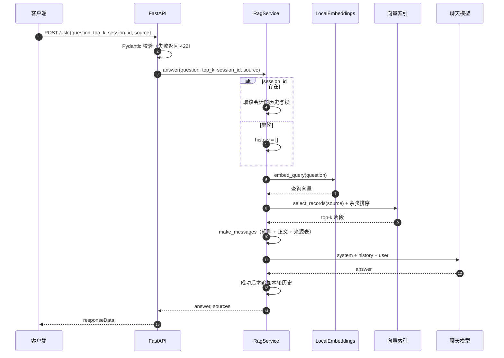
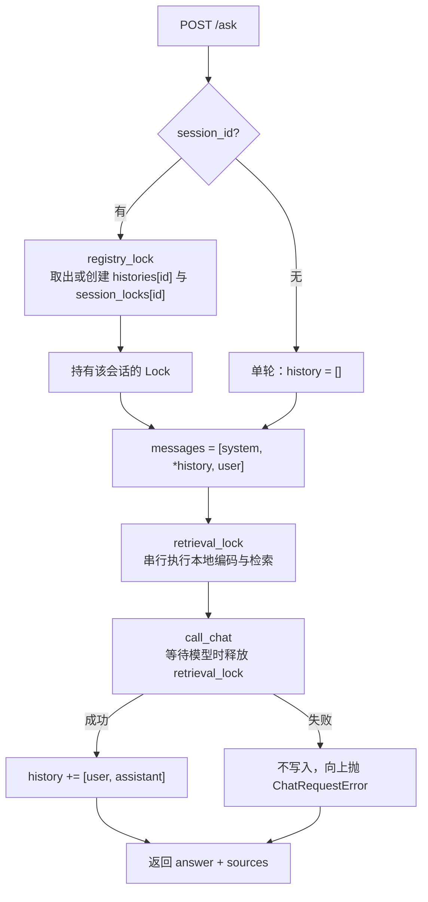
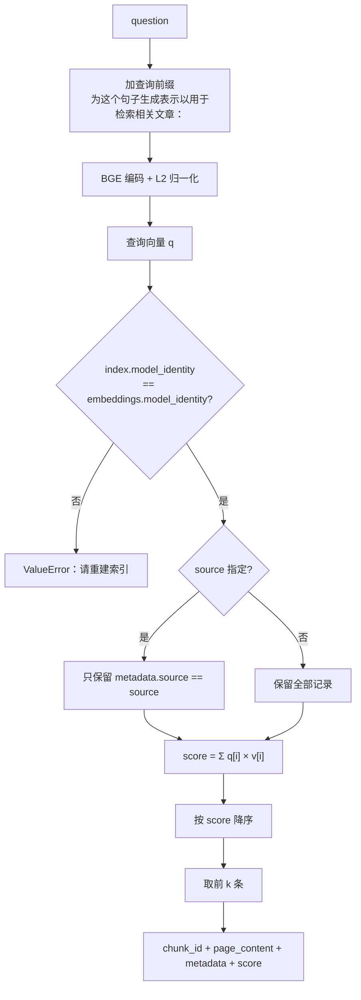
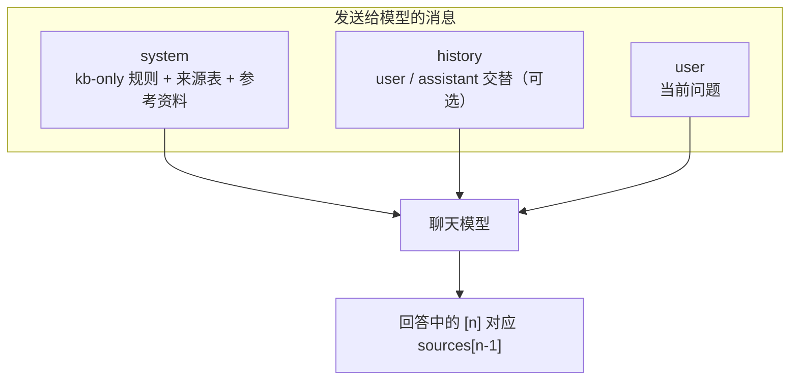
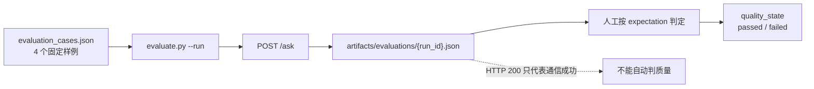

# P1 架构与逻辑

图示与 `rag_service/` 下的模块一一对应。Mermaid 可直接在 Obsidian、GitHub、Typora 中渲染。

## 1. 系统全景

## 2. 模块依赖

依赖方向单向向下：接口层不直接读文件，检索层不关心 HTTP，模型调用只依赖配置。

## 3. 离线索引流程

`indexing.py` 把“正文是否变化”和“编码模型是否变化”分开校验：内容指纹覆盖正文、来源、起始位置；
`model_identity` 覆盖模型 ID、revision、权重 sha256、维度和池化方式。

## 4. 在线问答时序

失败路径：配置缺失 `503`，上游调用失败 `502`；两种情况都不会写入会话历史。

## 5. 会话隔离与锁

锁的粒度：

| 锁 | 作用范围 | 目的 |
| --- | --- | --- |
| `retrieval_lock` | 全进程 | CPU 编码与全量排序串行，避免多线程争用 |
| `session_lock` | 单个 session | 同一会话的“读历史 → 调模型 → 写历史”原子化 |
| `registry_lock` | 全进程 | 保护 `histories` / `session_locks` 字典的创建 |

## 6. 检索细节

来源过滤发生在排序之前，因此 `source` 会真正缩小候选集合，而不是先取全局 top-k 再过滤。

## 7. 提示词结构

`policy.py` 的规则明确：资料不足时只能说明不足，不能补通用知识；引用必须来自本轮资料。
`prompt.py` 的 `build_context` 在每段正文前标注来源文件名，减少模型把不同文档的内容混在一起。

## 8. 错误边界

| 场景 | 检测位置 | HTTP 状态 | 是否进入检索/模型 |
| --- | --- | --- | --- |
| 空问题、超长问题、`top_k` 越界、空 `session_id`/`source` | Pydantic 校验 | 422 | 否 |
| `CHAT_*` 配置不完整 | `config.py` | 503 | 检索可能已完成，模型未调用 |
| 聊天模型网络/额度错误 | `llm.py` | 502 | 检索完成，模型调用失败 |
| 模型身份与索引不一致 | `retrieval.py` | 500 | 未编码查询，未调用模型 |
| 片段文件缺失或损坏 | `indexing.py` | 启动失败 | 服务不启动 |

## 9. 评测流程

评测样例覆盖两类失败模式：

1. **资料支持**：问题在知识库中有明确答案，检查引用是否来自正确文件。
2. **资料不足**：问题超出知识库范围，检查模型是否拒答而不是补通用知识。

第 4 个样例依赖同一会话的前一轮历史，用来验证会话读写在真实 HTTP 链路中生效。
