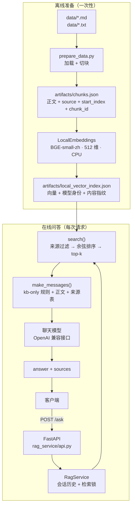

# 可追溯技术文档问答服务（RAG）

本地优先的 RAG 问答后端：文档加载 → 切块 → 本地 BGE 向量化 → 余弦检索 → 带出处回答。
支持 `top_k`、按来源过滤、进程内多会话隔离。

- 技术栈：Python 3.13 / FastAPI / LangChain（加载与切块）/ PyTorch / BGE-small-zh / pytest
- 适用岗位：RAG、AI 应用、后端开发
- 代码入口：`rag_service/api.py`

## 系统架构



向量只用于检索；交给聊天模型的是正文和来源表，不是 512 个浮点数。

## 数据流

**准备阶段**

```text
data/*.md|*.txt
  → TextLoader 保留 source
  → RecursiveCharacterTextSplitter（300 字符，50 重叠）
  → chunk_id = sha256(source:start_index:正文)
  → artifacts/chunks.json
```

**索引阶段**

```text
chunks.json
  → 本地 BGE 编码（CLS 池化 + L2 归一化，512 维）
  → artifacts/local_vector_index.json
  → 记录模型 revision、权重 sha256、内容指纹
```

**提问阶段**

```text
问题 → BGE 查询向量 → 来源过滤 → 余弦排序 → top-k 片段
     → 回答规则 + 正文 + 来源表 → 聊天模型 → answer + sources
```

索引的内容指纹或模型身份变化时会整组重建；未变化则直接复用。

## 快速开始

需要 Python 3.13。

```bash
pip install -r requirements.txt
python download_model.py          # 下载 bge-small-zh-v1.5 到 models/
cp .env.example .env              # 填入聊天模型配置
python prepare_data.py            # data/ → artifacts/chunks.json
```

本地检索（不联网，不调用聊天模型）：

```bash
python ask.py --question "不同用户的聊天历史为什么会混在一起？"
```

启动 HTTP 服务：

```bash
python -m rag_service.api          # 默认 127.0.0.1:8008
```

另开终端：

```bash
python http_client.py --health
python http_client.py --question "工具声明会自动执行函数吗？"
python http_client.py --question "归一化是什么？" --top-k 3
python http_client.py --question "会话为什么会混用？" --source "对话记忆.txt"
python http_client.py --session A --question "工具声明会自动执行函数吗？"
python http_client.py --session A --question "我刚才问的是什么？"
```

## 接口

`POST /ask`

```json
{
  "requestData": {
    "question": "不同用户的聊天历史为什么会混在一起？",
    "top_k": 2,
    "session_id": "review-A",
    "source": "对话记忆.txt"
  }
}
```

| 字段 | 规则 |
| --- | --- |
| `question` | 必填，1–2000 字符，去空白后非空 |
| `top_k` | 可选，默认 2，范围 1–5 |
| `session_id` | 可选，填写后延续该会话历史；不填为单轮 |
| `source` | 可选，只检索该来源文件；不填检索全部 |

响应：

```json
{
  "responseData": {
    "answer": "不同 session_id 共用同一历史对象时消息会混用。[1] 对话记忆.txt",
    "sources": [
      {
        "citation_id": 1,
        "source": "对话记忆.txt",
        "chunk_id": "85ba1dc5...",
        "start_index": 0
      }
    ],
    "session_id": "review-A",
    "source": "对话记忆.txt"
  }
}
```

错误约定：非法输入 `422`（不进入检索、不调用模型）；模型未配置 `503`；上游调用失败 `502`。

## 关键设计

**本地 BGE，而不是 Embedding API。** 检索是高频、低延迟且隐私敏感的一步。`bge-small-zh-v1.5`
在 CPU 上编码 4 条片段几乎是瞬时的，并且完全离线、可复现。固定 revision 和权重 sha256
会写入 `model_identity`，模型一变就拒绝复用旧索引。

**手写全量余弦，而不是 FAISS / Milvus。** 当前知识库只有 4 个片段，全量排序最简单、可解释、
零依赖，分数可以直接观察。规模是明确的边界；需要时保持 `search` 接口不变，只替换实现。

**回答范围限定知识库（`kb-only-v1`）。** 知识结论只能来自本轮检索资料，资料不足就明说，
不能补通用定义、公式或猜测数字。这样每条结论都能回查到片段，回答的可信度可以被验证。

**会话历史放进程内存。** 这是当前范围：验证不同 `session_id` 的历史隔离与并发串行。
重启即丢失，没有 Redis/DB，也没有身份认证，这是特性演示而不是生产会话后端。

**引用使用 `chunk_id` + `start_index`。** 回答里的 `[1]` 对应 `sources` 列表；`chunk_id` 是
正文的稳定哈希，`start_index` 可以在源文件里定位原文。

## 评测

固定 4 例评测集，覆盖正例和两类“资料不足”场景：

| 样例 | 预期 |
| --- | --- |
| 工具声明会自动执行函数吗？ | 回答“不会”，说明由应用执行，引用 `工具与检索.md` |
| 归一化是什么？ | 说明知识库无资料，不补 Min-Max/Z-score/公式 |
| 公司年假多少天？ | 说明缺制度文档，不给天数或猜测 |
| 同会话“我刚才问的是什么？” | 依据会话消息回忆，不当作知识问题 |

```bash
python evaluate.py          # 只展示样例
python evaluate.py --run    # 发起 4 次真实请求并保存记录
```

成功标准不是 HTTP 200，而是按预期人工判定答案。评测记录中的 `quality_state` 留待人工打勾。

## 测试

```bash
pytest -q    # 40 项，全部离线，不消耗聊天额度
```

覆盖输入校验、错误码映射、来源过滤、会话隔离与并发串行、提示词组装与模型身份校验。

## 目录

```text
├── rag_service/
│   ├── api.py           FastAPI 入口与请求模型
│   ├── service.py       RagService：检索、历史、锁
│   ├── retrieval.py     来源过滤 + 余弦排序
│   ├── prompt.py        上下文与消息组装
│   ├── policy.py        kb-only 回答规则
│   ├── embeddings.py    本地 BGE 编码
│   ├── indexing.py      切块与索引构建
│   ├── llm.py           聊天模型调用
│   ├── config.py        CHAT_* 配置
│   └── paths.py         项目路径
├── tests/
├── prepare_data.py
├── ask.py
├── evaluate.py
├── http_client.py
├── download_model.py
└── langchain_baseline.py
```

## 已知边界

- 全量余弦只适合小知识库，未接 HNSW/FAISS。
- 会话历史仅在进程内，重启丢失，无身份绑定。
- 每轮只编码当前问题，未做查询改写或指代消解。
- 输入变化时整组重建向量，未做增量索引。
- 300 字符固定切块 + 50 重叠，未按语义或标题切分。

## 学习来源

本项目跟随开源教程 [didilili/ai-agents-from-zero](https://github.com/didilili/ai-agents-from-zero)
的章节动手实现，教程提供了概念框架和学习路径，代码为本项目独立完成。
